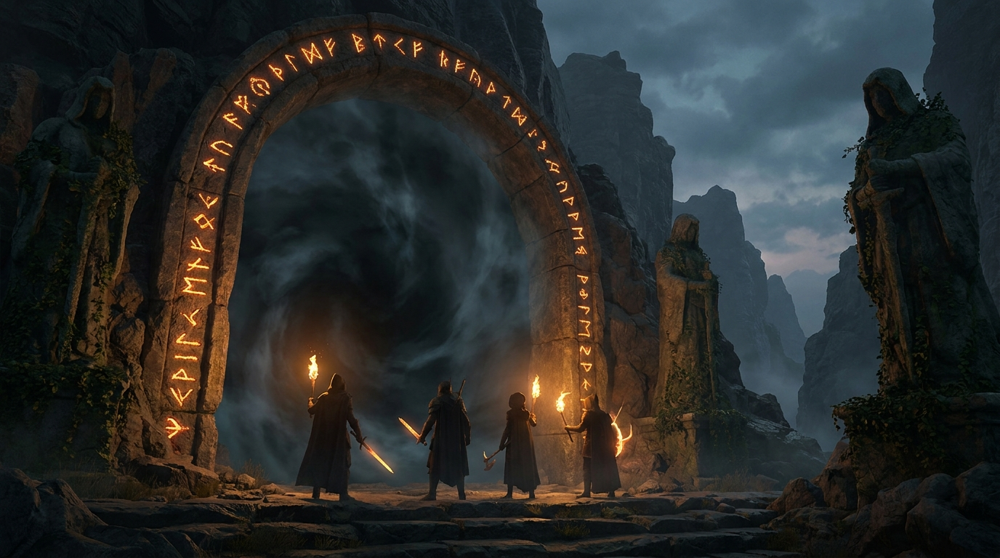
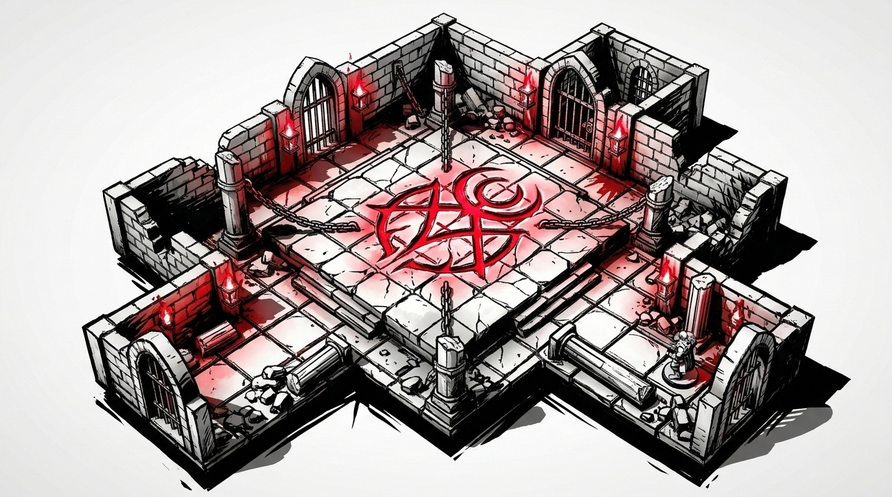
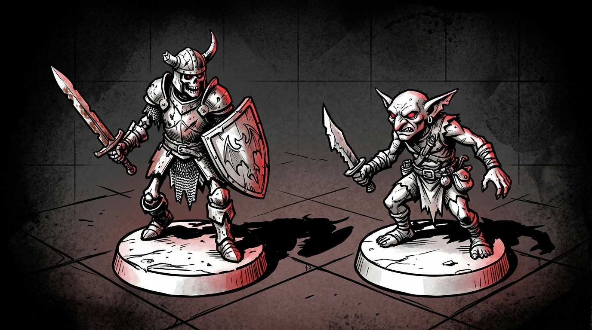
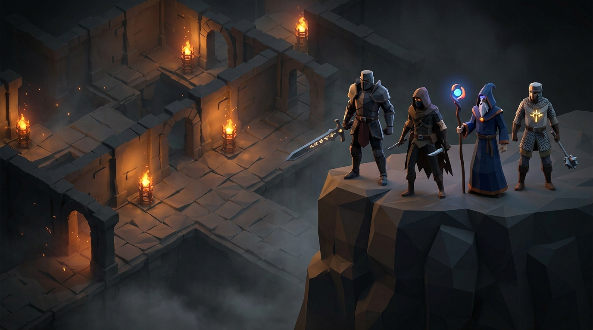
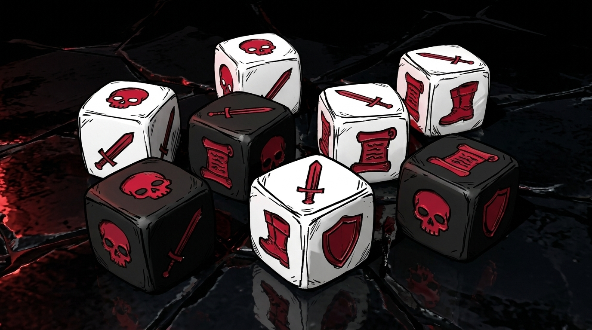
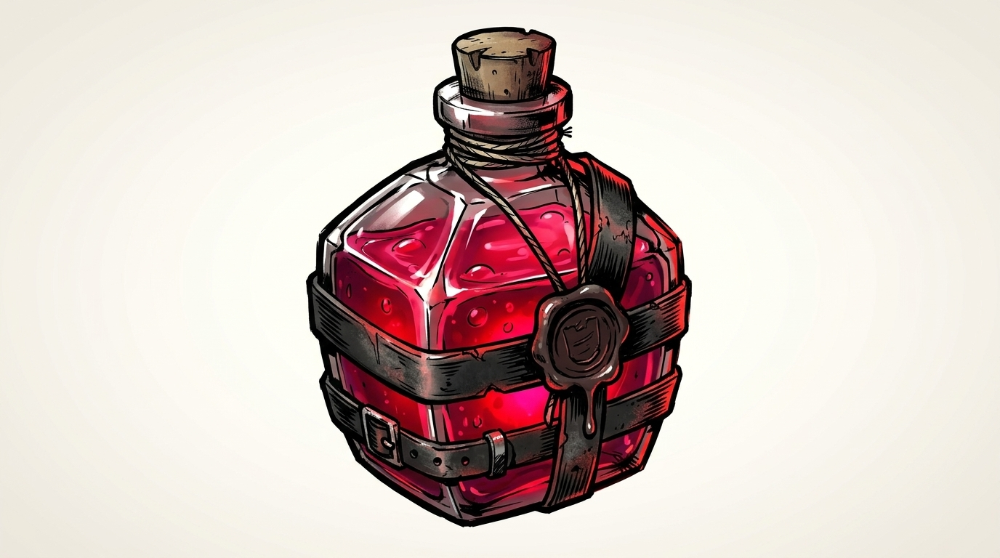
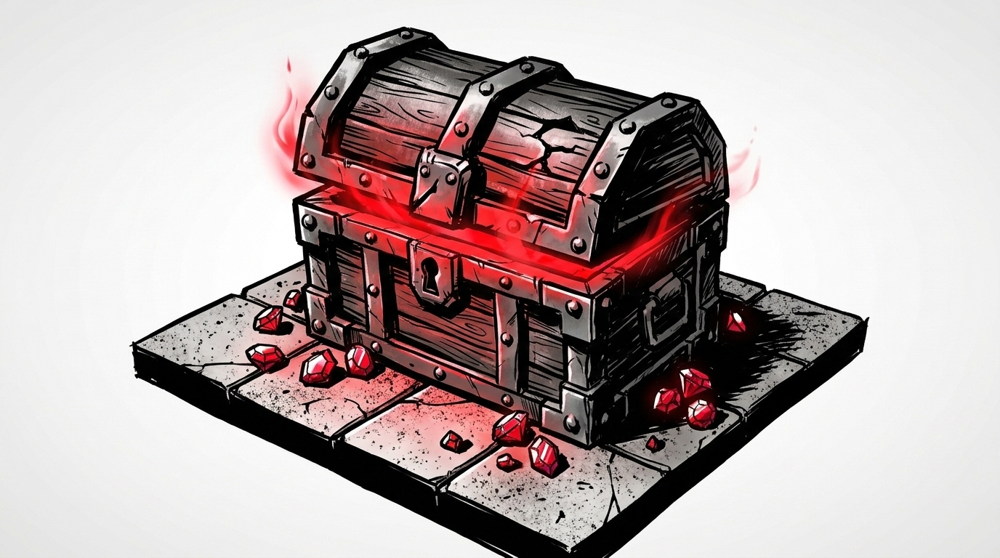

<p align="center">
  
</p>

<h1 align="center">⚔️ TINY DUNGEON ⚔️</h1>
<p align="center">
  <strong>The Ember Measure — Dark Isometric Roll-and-Write</strong><br>
  <em>Uma adaptação tática fiel ao clássico <strong>Paper Dungeons</strong> em 3D low-poly com iluminação dinâmica e estética luxury dark inspirada em <strong>Vesperfall</strong>.</em>
</p>

<p align="center">
  <a href="https://two2dope.github.io/tiny-dungeon/hero.html">
    
  </a>
  <a href="https://github.com/two2dope/tiny-dungeon">
    
  </a>
  
</p>

<p align="center">
  
  
  
  
  
</p>

---

## 🏰 Galeria Visual & Pilares de Experiência

<table>
  <tr>
    <td width="50%">
      
      <h4 align="center">🏛️ Lajes Isométricas em Three.js</h4>
      <p align="center"><em>Geometria procedural de pedra polida com tochas orgânicas tremeluzentes e colisão real de paredes.</em></p>
    </td>
    <td width="50%">
      
      <h4 align="center">👹 Desafios de Monstros & Minions</h4>
      <p align="center"><em>Goblins, Esqueletos, Orcs e Trolls. Nível suficiente anula ferimentos e rende pontos de Glória.</em></p>
    </td>
  </tr>
  <tr>
    <td width="50%">
      
      <h4 align="center">🛡️ A Comitiva das Quatro Classes</h4>
      <p align="center"><em>Guerreiro, Mago, Clérigo e Ladino com trilhas independentes de evolução (níveis 1 a 6).</em></p>
    </td>
    <td width="50%">
      
      <h4 align="center">🎲 O Destino nos Dados (Drafting)</h4>
      <p align="center"><em>6 dados por rodada (3 brancos, 3 pretos). Escolha até 3 para andar, subir de nível ou forjar itens.</em></p>
    </td>
  </tr>
  <tr>
    <td width="50%">
      
      <h4 align="center">🧪 Alquimia & Poções Vitais</h4>
      <p align="center"><em>Destile elixires carmesins para recuperar instantaneamente 2 corações de vida.</em></p>
    </td>
    <td width="50%">
      
      <h4 align="center">💎 Gemas Preciosas & Artefatos</h4>
      <p align="center"><em>Forje itens mágicos e saqueie cofres esquecidos (+2 pontos de Glória por tesouro).</em></p>
    </td>
  </tr>
</table>

---

## 📜 Regras Canônicas Implementadas

> [!IMPORTANT]
> **Fidelidade Mecânica Integral:** Todas as regras da edição base de *Paper Dungeons* foram transcritas em funções puras testadas via TDD.

1. **8 Rodadas Estruturadas:** Cada partida transcorre em exatamente 8 rodadas com rolagem de dados e fase de perigo.
2. **Fase de Perigo (Hazard Phase):** Se a rolagem inicial de 6 dados resultar em **3 ou mais crânios**, o grupo sofre 1 ferimento involuntário antes do rascunho de ações.
3. **Movimentação Tática com BFS:** O dado de bota concede até 2 passos adjacentes. Paredes maciças de pedra bloqueiam passagens diretas (verificadas pelo grafo canônico do Mapa 1).
4. **Sem Permadeath Prematuro:** A perda total de corações aplica uma **Penalidade de Ressurreição (-9 Glória no final)** e reanima o grupo para completar toda a expedição.
5. **Segurança de Decisão (Undo / Redo):** Ensaie movimentos no tabuleiro 3D, veja o desfecho do combate e desfaça livremente antes de acionar *Confirmar Rodada*.
6. **Confrontos com Chefes Solo (Rodadas 3, 6 e 8):**
   - **Rodada 3 — Mantícora:** Poder Requerido `6` (Tier 1: +8 Glória) / `4` (Tier 2: +4 Glória) / Derrota: 2 ferimentos.
   - **Rodada 6 — Tirano Ocular:** Poder Requerido `10` (Tier 1: +12 Glória) / `7` (Tier 2: +6 Glória) / Derrota: 3 ferimentos.
   - **Rodada 8 — Dragão Vermelho Ancião:** Poder Requerido `14` (Tier 1: +16 Glória) / `10` (Tier 2: +8 Glória) / Derrota: 4 ferimentos.
7. **Apuração de Glória Final:**
   $$\text{Glória Líquida} = \text{Monstros} + \text{Chefes} + \text{Gemas} \times 2 + \text{Artefatos} \times 2 + \sum \text{Níveis} - (\text{Ressurreições} \times 9)$$

---

## 🏗️ Arquitetura de Software

```
tiny-dungeon/
├── hero.html                 # Hero Landing Page de alta fidelidade visual
├── public/assets/            # Ativos visuais e mídias cinematográficas
├── src/
│   ├── engine/               # Domínio Puro TypeScript (100% testável sem DOM)
│   │   ├── types.ts          # Contratos e tipos formais
│   │   ├── dice.ts           # Rascunho de dados, faces e fase de perigo
│   │   ├── heroes.ts         # As 4 classes, vida, poções e ressurreição
│   │   ├── dungeon.ts        # Matriz 4x4 do Mapa 1, paredes e BFS
│   │   ├── combat.ts         # Resolutores de Minions e Chefes solo
│   │   └── scoring.ts        # Cálculo exaustivo de glória final
│   │
│   ├── store/                # Máquina de Estados
│   │   └── gameStore.ts      # Zustand com pilha de snapshot para Undo/Redo e autosave
│   │
│   └── components/
│       ├── canvas/           # Gráficos 3D em Three.js / React Three Fiber
│       │   ├── DungeonCanvas.tsx   # Viewport com câmera isométrica
│       │   ├── RoomTile3D.tsx      # Lajes chanfradas e marcadores luminosos
│       │   ├── Walls3D.tsx         # Paredes perimetrais e interiores
│       │   ├── TorchLight.tsx      # Tochas com cintilação procedural
│       │   └── PartyPawn3D.tsx     # Marcador de coordenadas do grupo
│       │
│       └── ui/               # Interface DOM Dark Luxury (Tailwind CSS)
│           ├── HUD.tsx             # Barra de status superior e vitalidade
│           ├── EmberLedger.tsx     # The Ember Measure (livro dos heróis)
│           ├── DiceTray.tsx        # Bandeja interativa dos 6 dados
│           ├── CombatLog.tsx       # Registro narrativo de exploração
│           └── EndGameModal.tsx    # Certificado laureado de glória
│
└── tests/                    # Suíte de Testes Automatizados (Vitest)
    ├── smoke.test.ts
    ├── engine/               # Testes unitários do domínio
    ├── store/                # Testes da máquina de estado
    ├── components/           # Testes de renderização
    └── integration/          # Simulação completa da partida de 8 rodadas
```

---

## 🚀 Como Executar Localmente

### 1. Clonar e Instalar Dependências
```bash
git clone https://github.com/two2dope/tiny-dungeon.git
cd tiny-dungeon
npm install
```

### 2. Iniciar Servidor de Desenvolvimento
```bash
npm run dev
```
- **Jogo Principal:** [http://localhost:5173/](http://localhost:5173/)
- **Hero Page Showcase:** [http://localhost:5173/hero.html](http://localhost:5173/hero.html)

### 3. Rodar os Testes Automatizados
```bash
npm test
```
> Executa 22 testes unitários e de integração com cobertura total dos cenários de regra.

### 4. Compilar para Produção
```bash
npm run build
```

---

## 📜 Documentação Técnica
- [Documento de Design / Spec](docs/superpowers/specs/2026-10-23-tiny-dungeon-design.md)
- [Plano de Implementação Detalhado](docs/superpowers/plans/2026-10-23-tiny-dungeon-implementation-plan.md)
- [Registro de Estado do Projeto](STATE.md)

---

## ⚖️ Licença
Distribuído sob a licença **MIT**. Criado com inspiração no universo de *Paper Dungeons* e na direção de arte de *Vesperfall*.
