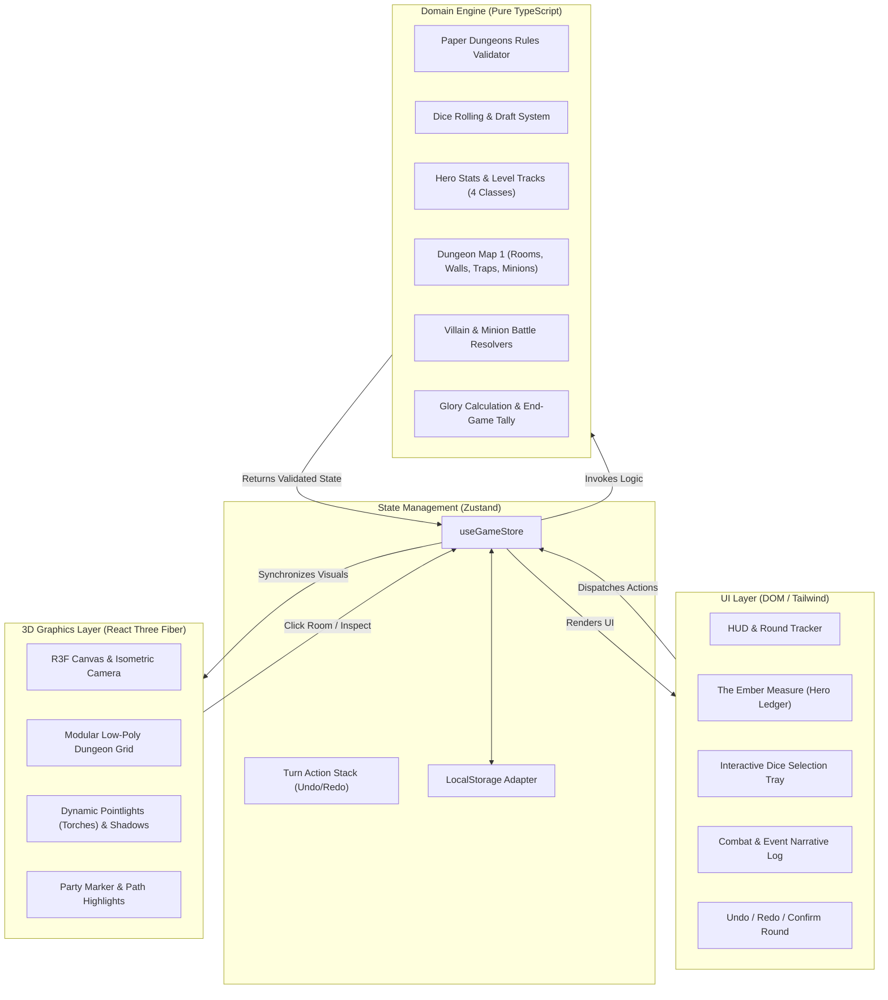

# Tiny Dungeon - Design Document

**Date:** 2026-10-23  
**Status:** In Review (Brainstorming Phase)  
**Target:** `c:\Users\Thomáz\Projetos\01_dev-systems\tiny-dungeon`

---

## 1. Intent & The Why

*Tiny Dungeon* is a standalone single-player web application game that reimagines the acclaimed roll-and-write board game **Paper Dungeons** (and its expansion *Sidequest*) as an evocative, dark-fantasy 3D isometric dungeon crawler.

While traditional digital roll-and-write adaptations often feel like flat digital PDFs or sterile spreadsheets, *Tiny Dungeon* adopts the visual language and moody atmosphere of high-end dark fantasy web experiences (specifically inspired by **Vesperfall / ref-c**):
- Low-poly isometric architecture with real-time torchlights and casting shadows.
- An elegant, dark-mode serif UI (inspired by "The Ember Measure" attribute ledger).
- The tactical depth, math integrity, and party-building mechanics of Paper Dungeons, enhanced by interactive path assistance, combat simulation, and single-turn Undo/Redo.

---

## 2. Goals, Non-Goals, and Anti-Goals

### Goals
- **Full Base Game Fidelity:** Implement the official Paper Dungeons base rules across 8 rounds:
  - 4-hero party (Guerreiro, Mago, Clérigo, Ladino) with individual level tracks, abilities, and power thresholds.
  - 6-dice drafting system (3 white dice, 3 black dice), selecting 3 dice per round to trigger movement, leveling, or crafting (magic items & potions).
  - Canonical Dungeon Map 1 with rooms, walls, corridors, minions, traps, gems, and 3 Villain/Boss encounters (Rounds 3, 6, 8).
  - Automated glory scoring calculation at end-game.
- **Atmospheric 3D Presentation (ref-c aesthetic):**
  - Isometric view powered by React Three Fiber (Three.js) with procedural low-poly stonework, arches, pillars, flickering torches, and dynamic lighting.
  - Character party represented on the board with illuminated active coordinates and path projection.
- **High-End Dark UI (DOM Overlay):**
  - Crisp HTML/Tailwind overlay for hero ledger, dice selection tray, combat log, and round tracker.
  - Serif headings (Cinzel / Playfair Display) with clean tabular numerals for stats.
- **Player Assistance & UX Safety:**
  - Visual highlighting of legal moves on the 3D map when selecting dice.
  - Non-destructive turn planning: players can stage moves, inspect combat outcomes, and use **Undo / Redo** freely before clicking "Confirm Round".
- **Local Persistence:** Autosave state to `localStorage` after each confirmed round.
- **Modular Extensibility:** Clean decoupling so *Sidequest* expansion features (waterways, treasure chests, sidequest cards, sergeants, artifacts) can be plugged in without refactoring core systems.

### Non-Goals (Scope for v1)
- Real-time action combat with WASD/physics (the game remains strictly turn-based tactical roll-and-write).
- Real-time online multiplayer or matchmaking lobby (v1 is purely single-player).
- Full suite of 12 dungeon maps on day one (focus on canonical Dungeon 1 with robust seed/procedural foundation).
- Sidequest expansion content in initial sprint (data models prepared, content deferred to v1.1).

### Anti-Goals
- Cluttered, text-heavy spreadsheet UI that obscures the dungeon board.
- Heavy asset pipelines requiring gigabytes of downloaded GLTF files before the game is playable.
- Obscure game state rules where players cannot understand why an action is blocked or how combat damage was calculated.

---

## 3. Constraints

- **Platform:** Modern web browsers with WebGL 2.0 support (desktop and tablet responsive).
- **Performance:** 60 FPS rendering in Three.js on standard integrated GPUs via low-poly geometry and baked/simple shadow maps.
- **Zero-Dependency Startup:** Procedural geometry primitives (boxes, cylinders, bevels) built directly via Three.js code, ensuring instant out-of-the-box preview without relying on external 3D asset CDNs.
- **Deterministic Game Logic:** Pure TypeScript domain model, 100% testable without a browser or WebGL context.

---

## 4. Approaches Considered

| Approach | Description | Trade-offs | Verdict |
| :--- | :--- | :--- | :--- |
| **1. Decoupled Architecture (Engine TS + R3F 3D + React DOM HUD)** | Pure TypeScript game engine (`@engine`) completely decoupled from graphics. R3F handles the 3D isometric view. React/Tailwind handles HUD and hero ledger. Zustand coordinates state. | Requires clear store contracts between engine and 3D scene, but offers 100% testable rules via TDD, clean separation, and highest maintainability. | **Selected (Recommended by Agent & User)** |
| **2. 3D Monolithic Canvas-First** | Entire game state and interaction logic embedded inside the Three.js scene loop with raycasting and canvas text. | Faster initial visual hack, but extremely hard to test with automated suites, poor text rendering/accessibility, high technical debt. | Rejected |
| **3. Progressive 2D to 3D** | Build 100% of the game in 2D HTML/SVG first, then graft Three.js on top later. | Lower initial risk on 3D, but delays the visual identity and camera/spatial UX that defines the user's primary excitement for the project. | Rejected |

---

## 5. System Architecture & Component Specifications

### 5.0 Official Rules Formalization & Builder Resolutions
Following the technical builder review, the core gameplay loop adheres strictly to the canonical Paper Dungeons rules:
- **Death & Defeat:** No premature Game Over / permadeath. If the party's health track is depleted, a **Resurrection Penalty** is applied (-9 Glory points per death at final tally) and the party recovers partial vitality to complete all 8 rounds.
- **Solo Boss Battles (Rounds 3, 6, 8):** Resolved via the official solo threshold table. Party total level is compared to the Villain's combat power:
  - *Heroic Victory (Tier 1):* Full glory points awarded.
  - *Standard Victory (Tier 2):* Reduced glory awarded.
  - *Defeat:* 0 glory and party suffers villain wound penalty.
- **Setup & Canonical Map 1:** Starts with a curated canonical loadout (Map 1 layout, 3 preset Bosses, 2 public Missions) with a seedable card deck architecture ready for random configurations.
- **Movement Mechanics:** Each movement die action grants up to **2 steps** (adjacent rooms). Moving through previously cleared rooms incurs no penalty. Unexplored rooms immediately trigger traps or minion challenges on entry.
- **Hazard Phase (Skulls):** If the initial 6-dice roll produces 3 or more skulls, 1 group wound is dealt during the automated Hazard Phase before player drafting.

### 5.1 Tech Stack
- **Framework:** React 19 + TypeScript + Vite
- **3D Engine:** Three.js + `@react-three/fiber` + `@react-three/drei`
- **State Management:** Zustand (with temporal middleware or custom action stack for undo/redo)
- **Styling & Design System:** Tailwind CSS + Lucide React + Google Fonts (Cinzel / Cormorant Garamond / Inter)
- **Testing:** Vitest for core engine unit tests

### 5.2 Core Modules (`src/engine/`)
1. `types.ts`: Domain models (`HeroClass`, `HeroState`, `Die`, `DieSymbol`, `DungeonCoord`, `RoomState`, `Minion`, `Villain`, `RoundPhase`, `GameSession`).
2. `dice.ts`: Dice pool generation (3 white, 3 black), face mappings (Boots, Swords, Magic, Rogue Tools, Shield, Skull/Damage), drafting rules.
3. `heroes.ts`: The 4 classes (Warrior, Mage, Cleric, Rogue), level tracks (1 to 6+), active perks, damage hearts, potion crafting capacity, item inventory.
4. `dungeon.ts`: Dungeon Map 1 matrix (grid coords, walls, doors, minions, traps, gems, keys, boss rooms). Adjacency graph for movement validation.
5. `combat.ts`:
   - Minion battles: Check party level requirement, apply wounds if under-leveled, award glory/gems.
   - Villain battles (Rounds 3, 6, 8): Multi-hero strength calculation vs boss modifier, calculate relative wounds and glory rank.
6. `scoring.ts`: Final glory tally: minions defeated + villains beaten + gems + crafted items + hero levels - wound penalties.

### 5.3 3D Rendering System (`src/components/canvas/`)
1. `DungeonGrid3D`: Generates the 3D room floorplates, beveled edges, stone texture noise (via procedural materials).
2. `WallsAndDoors3D`: Renders stone walls and arches between rooms according to Map 1 layout.
3. `Torchlight`: Point lights with animated flicker intensity and warm color (`#ff7a29` to `#ffae42`) casting soft shadows.
4. `PartyPawn3D`: Low-poly party representation with glowing coordinate ring on current active room.
5. `PathHighlighter`: Emissive indicator on adjacent reachable rooms when movement die is active.

### 5.4 UI / HUD System (`src/components/ui/`)
1. `EmberLedger` (Hero Sheet): Modal or collapsible drawer styled after *ref-c* ("The Ember Measure"), showing the 4 heroes, their equipment/potions, and level-up buttons.
2. `DiceTray`: Displays the 6 rolled dice, allows selecting 3, highlights active selection.
3. `ActionControls`:
   - "Desfazer (Undo)"
   - "Refazer (Redo)"
   - "Confirmar Rodada (Confirm Turn)"
4. `CombatLog`: Narrative scroll detailing actions, damage taken, and treasures acquired.
5. `RoundTracker`: Top bar showing Round N of 8 and countdown to upcoming Boss fight.

---

## 6. What is Left to the Builder

- Exact tuning of torchlight attenuation, ambient shadow softness, and post-processing bloom.
- Particle system for floating embers in the dungeon scene.
- Sound effects (synthesized or CC0 audio for dice roll, torch ambient, button clicks).
- Keyboard shortcuts (`1-6` for dice, `Z` for undo, `Space` for confirm round).
